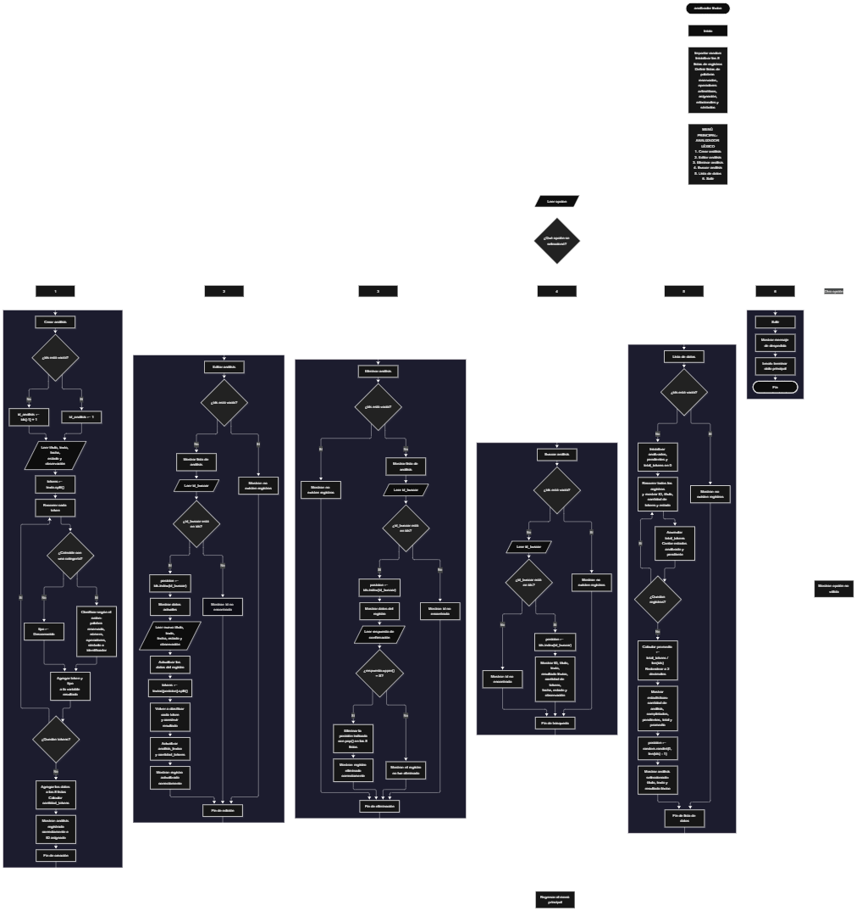

 

Este proyecto, llamado <b>analizador léxico</b>, fue desarrollado en <b>python</b> como un ejercicio práctico para fortalecer la lógica de programación mediante la creación de un sistema que permite analizar textos y fragmentos de código desde la consola. El programa cuenta con un menú principal de seis opciones que permite <b>crear, editar, eliminar, buscar y consultar los análisis léxicos registrados</b>. Cada análisis almacena información como el título, el texto o código introducido, el resultado de la clasificación de tokens, la cantidad de tokens, la fecha, el estado y las observaciones. Para organizar la información, se utilizan ocho listas paralelas que mantienen los datos relacionados mediante sus posiciones correspondientes. Durante su desarrollo se aplicaron conceptos fundamentales de programación, como variables, listas, estructuras condicionales, ciclos repetitivos, métodos de cadenas y operaciones de búsqueda, modificación y eliminación de registros. También se implementaron estadísticas sobre los análisis almacenados y la selección aleatoria de un registro. Este proyecto permite poner en práctica los conocimientos adquiridos en python y sirve como base para comprender los principios fundamentales del análisis léxico.

<h2 align="center">⚙️ Funcionamiento del menú principal</h2>

### ➕ Crear análisis

La opción <b>1) crear análisis</b> permite registrar un nuevo análisis léxico. Primero, el programa genera un identificador mediante la variable <b>id_analisis</b>. Si no existen registros, asigna el valor <b>1</b>; en caso contrario, utiliza el último identificador almacenado más uno mediante la expresión <b>ids[-1] + 1</b>. Después, solicita el <b>título, texto o código, fecha, estado y observación</b> del análisis. El texto introducido se divide en tokens mediante el método <b>split()</b>, que separa el contenido utilizando los espacios en blanco. A continuación, un ciclo <b>for</b> recorre los tokens y una estructura condicional <b>if, elif y else</b> determina su categoría según las listas de palabras reservadas, operadores y símbolos, así como las condiciones para reconocer números e identificadores. El resultado se almacena en la variable <b>resultado</b>, utilizando el formato <b>token -&gt; tipo</b>. Finalmente, los datos se guardan en las ocho listas correspondientes, mientras que la cantidad de tokens se calcula mediante <b>len(tokens)</b>. El programa muestra el mensaje <b>"análisis registrado correctamente."</b> junto con el identificador asignado.

### ✏️ Editar análisis

La opción <b>2) editar análisis</b> permite modificar la información de un análisis registrado. Primero, el programa comprueba si existen registros mediante la condición <b>len(ids) == 0</b>. Si las listas están vacías, muestra el mensaje <b>"no existen registros."</b>. En caso contrario, presenta una lista con el identificador, el título, la cantidad de tokens y el estado de cada análisis. Después, solicita el identificador del registro que se desea editar y comprueba si está presente en la lista <b>ids</b>. Si existe, utiliza <b>ids.index(id_buscar)</b> para obtener su posición y muestra los datos actuales. A continuación, solicita el nuevo título, texto o código, fecha, estado y observación, actualizando los valores de las listas correspondientes. Una vez modificado el texto, vuelve a dividirlo en tokens mediante <b>split()</b> y aplica nuevamente las condiciones de clasificación léxica. El resultado actualizado se almacena en <b>analisis_lexico[posicion]</b> y la cantidad de tokens se actualiza en <b>cantidad_tokens[posicion]</b>. Finalmente, muestra el mensaje <b>"registro actualizado correctamente."</b>. Si el identificador no se encuentra en la lista, presenta el mensaje <b>"id no encontrada."</b>.

### 🗑️ Eliminar análisis

La opción <b>3) eliminar análisis</b> permite eliminar un análisis registrado mediante su identificador. Antes de comenzar, el programa comprueba si existen registros almacenados. Si no hay análisis disponibles, muestra el mensaje <b>"no existen registros."</b>. En caso contrario, presenta una lista con los identificadores, títulos, cantidades de tokens y estados. Después, solicita el identificador del registro que se desea eliminar y comprueba si existe en la lista <b>ids</b>. Si lo encuentra, obtiene su posición mediante <b>ids.index(id_buscar)</b> y muestra los datos principales del registro seleccionado. A continuación, solicita una confirmación mediante la pregunta <b>"¿desea eliminar este registro? (s/n):"</b>. Si la respuesta convertida a mayúsculas mediante <b>upper()</b> es igual a <b>"S"</b>, el programa utiliza el método <b>pop(posicion)</b> para eliminar los datos de las ocho listas: <b>ids, titulos, textos, analisis_lexico, cantidad_tokens, fechas, estados y observaciones</b>. De esta manera, mantiene la correspondencia entre los datos restantes. Finalmente, muestra el mensaje <b>"registro eliminado correctamente."</b>. Si el usuario no confirma la operación, presenta el mensaje <b>"el registro no fue eliminado."</b>. Si el identificador no existe, muestra <b>"id no encontrada."</b>.

### 🔎 Buscar análisis

La opción <b>4) buscar análisis</b> permite localizar un registro mediante su identificador. Primero, el programa comprueba si existen análisis almacenados. Si no hay registros, muestra el mensaje <b>"no existen registros."</b>. En caso contrario, solicita el identificador del análisis y comprueba si está presente en la lista <b>ids</b>. Cuando encuentra una coincidencia, utiliza <b>ids.index(id_buscar)</b> para localizar la posición correspondiente y muestra el identificador, título, texto original, resultado del análisis léxico, cantidad de tokens, fecha, estado y observación. De esta manera, el usuario puede consultar tanto el contenido original como las categorías asignadas a cada token. Si el identificador introducido no corresponde a ningún registro, el programa presenta el mensaje <b>"id no encontrada."</b>.

### 📋 Lista de datos

La opción <b>5) lista de datos</b> permite visualizar los análisis registrados y consultar estadísticas generales del proyecto. Antes de comenzar, el programa comprueba si existen registros. Si las listas están vacías, muestra el mensaje <b>"no existen registros."</b>. En caso contrario, inicializa las variables <b>analizados, pendientes y total_tokens</b> con el valor cero. Después, utiliza un ciclo <b>for</b> para recorrer los registros y mostrar el identificador, título, cantidad de tokens y estado de cada análisis. Durante el recorrido, acumula la cantidad total de tokens y cuenta los registros cuyo estado coincide, sin distinguir entre mayúsculas y minúsculas, con <b>"analizado"</b> o <b>"pendiente"</b>, mediante el método <b>lower()</b>. Al finalizar, calcula el promedio de tokens por análisis dividiendo <b>total_tokens</b> entre la cantidad de registros y redondeando el resultado a dos decimales con <b>round(promedio, 2)</b>. Posteriormente, muestra la cantidad de análisis, los análisis completados, los pendientes, el total de tokens y el promedio. Finalmente, utiliza <b>random.randint(0, len(ids) - 1)</b> para seleccionar aleatoriamente uno de los registros y presentar su título, texto original, resultado léxico y clasificación de tokens. Esta opción facilita consultar el estado general de los análisis y revisar uno de ellos de forma aleatoria.

### 🚪 Salir del menú principal

La opción <b>6) salir</b> permite finalizar la ejecución del programa. Cuando el usuario selecciona esta opción, el programa muestra el mensaje <b>"gracias por utilizar el analizador lexico."</b> y utiliza la instrucción <b>break</b> para interrumpir el ciclo principal <b>while True</b>. De esta manera, el menú deja de repetirse y la ejecución del programa termina. Si el usuario introduce un valor que no corresponde a ninguna de las seis opciones disponibles, el bloque <b>else</b> muestra el mensaje <b>"opción no válida."</b> y permite volver al menú principal.

<h2 align="center">🧠 Temas aplicados en el proyecto</h2>

### 📦 Variables

En este proyecto se utilizan variables para controlar la opción seleccionada en el menú, generar identificadores, almacenar temporalmente el texto introducido, clasificar los tokens, calcular estadísticas y localizar los registros que se desean modificar, eliminar o consultar. Cada variable cumple una función específica dentro de las operaciones del analizador léxico.

🔢 **Opcion:** Almacena la opción seleccionada por el usuario en el menú principal.

🆔 **Id_analisis:** Almacena el identificador que se asigna al nuevo análisis.

🔎 **Id_buscar:** Almacena el identificador introducido para localizar un registro.

📍 **Posicion:** Representa el índice del registro encontrado dentro de las listas.

📝 **Texto:** Almacena el texto o código que se desea analizar durante el registro.

🔠 **Tokens:** Almacena temporalmente las partes del texto separadas mediante el método `split()`.

📋 **Resultado:** Construye la representación textual de los tokens y sus categorías.

🏷️ **Tipo:** Almacena la categoría asignada a cada token, como palabra reservada, número, operador o identificador.

📊 **Cantidad_tokens:** En la lista con este nombre, almacena la cantidad de tokens de cada análisis.

🔄 **Analizados y pendientes:** Son variables que cuentan los registros según sus estados durante la consulta estadística.

➕ **Total_tokens:** Acumula la cantidad de tokens de todos los análisis registrados.

📈 **Promedio:** Almacena el promedio de tokens por análisis.

🎲 **I:** Funciona como contador en los ciclos que recorren los registros y los tokens.

### 🗃️ Listas

En este proyecto se utilizan ocho listas paralelas para organizar la información de los análisis léxicos. Cada lista almacena un tipo de dato y utiliza la misma posición para relacionar los valores que pertenecen a un mismo registro. Por ejemplo, los datos del primer análisis se encuentran distribuidos entre <b>ids[0], titulos[0], textos[0], analisis_lexico[0], cantidad_tokens[0], fechas[0], estados[0] y observaciones[0]</b>. Esta organización permite consultar, modificar y eliminar registros manteniendo la correspondencia entre sus datos.

🆔 **Ids:** Almacena los identificadores de los análisis.

📝 **Titulos:** Guarda los títulos de los registros.

📄 **Textos:** Conserva los textos o fragmentos de código originales.

🔠 **Analisis_lexico:** Almacena los tokens clasificados y su representación textual.

🔢 **Cantidad_tokens:** Guarda el número de tokens encontrados en cada análisis.

📅 **Fechas:** Almacena las fechas introducidas por el usuario.

📌 **Estados:** Guarda el estado de cada análisis.

📋 **Observaciones:** Conserva las observaciones asociadas a cada registro.

### 🧩 Listas de clasificación léxica

El programa utiliza cuatro listas de referencia para reconocer palabras reservadas, operadores aritméticos, operadores de asignación, operadores relacionales y símbolos. Estas listas se consultan durante el análisis de cada token y permiten determinar su categoría cuando existe una coincidencia exacta con alguno de los elementos almacenados.

🔑 **Palabras_reservadas:** Contiene elementos como `if`, `else`, `elif`, `for`, `while`, `print`, `input`, `def`, `class` y `return`, entre otros.

➗ **Operadores_aritmeticos:** Contiene los operadores `+`, `-`, `*`, `/` y `%`.

🟰 **Operadores_asignacion:** Contiene los operadores `=`, `+=`, `-=`, `*=` y `/=`.

⚖️ **Operadores_relacionales:** Contiene los operadores `==`, `!=`, `>`, `<`, `>=` y `<=`.

🔣 **Simbolos:** Contiene los paréntesis, llaves, corchetes, dos puntos, comas y punto y coma.

### 🔀 Estructuras condicionales

En este proyecto se utilizan las estructuras <b>if, elif y else</b> para controlar el funcionamiento del menú, determinar si existen registros, comprobar la presencia de un identificador en la lista y decidir qué categoría corresponde a cada token. Durante el análisis léxico, las condiciones se evalúan en un orden específico: primero se comprueba si el token pertenece a las palabras reservadas; después, si representa un número, un operador aritmético, un operador de asignación, un operador relacional o un símbolo. Posteriormente, se verifica si cumple la condición utilizada para identificar nombres alfanuméricos con guiones bajos. Si ninguna condición se cumple, se clasifica como <b>"Desconocido"</b>. Estas estructuras permiten ejecutar diferentes instrucciones según los datos introducidos y los resultados obtenidos.

### 🔄 Estructuras repetitivas

En este proyecto se utilizan los ciclos <b>while</b> y <b>for</b>. El ciclo <b>while True</b> mantiene activo el menú principal hasta que se selecciona la opción de salida, que utiliza <b>break</b> para terminar la repetición. Los ciclos <b>for</b> permiten recorrer los tokens del texto introducido, generar el resultado de la clasificación léxica, mostrar los registros almacenados y calcular las estadísticas generales. Estas estructuras facilitan procesar múltiples elementos sin tener que repetir manualmente las mismas instrucciones.

### 🎯 Estructura de selección del menú

El menú principal utiliza una cadena de condiciones <b>if, elif y else</b> para determinar qué operación debe ejecutarse según el valor de la variable <b>opcion</b>. Cada condición corresponde a una de las seis opciones disponibles: <b>crear, editar, eliminar, buscar, lista de datos y salir</b>. Si el valor introducido no coincide con ninguna opción, el bloque <b>else</b> muestra el mensaje <b>"opción no válida."</b>. Esta estructura organiza las funciones del programa y permite al usuario elegir qué operación desea realizar.

### 🔤 Métodos de cadenas

El programa utiliza diferentes métodos de cadenas para procesar el texto y clasificar sus elementos. El método <b>split()</b> separa el contenido en tokens utilizando los espacios en blanco. El método <b>isdigit()</b> permite comprobar si un token está compuesto por dígitos. El método <b>replace("_", "")</b> elimina temporalmente los guiones bajos para evaluar el contenido restante mediante <b>isalnum()</b>, que comprueba si una cadena contiene caracteres alfanuméricos. También se utilizan <b>lower()</b> y <b>upper()</b> para comparar los estados sin distinguir entre mayúsculas y minúsculas y para comprobar la confirmación de eliminación, respectivamente. Estos métodos facilitan el procesamiento de las cadenas introducidas por el usuario.

### 🔢 Operaciones numéricas y selección aleatoria

El programa utiliza las funciones <b>len()</b>, <b>round()</b> y <b>random.randint()</b> para realizar operaciones relacionadas con los registros. La función <b>len()</b> permite conocer la cantidad de elementos de una lista y calcular el número de tokens. La función <b>round()</b> redondea el promedio de tokens por análisis a dos decimales. Por su parte, <b>random.randint(0, len(ids) - 1)</b> genera un índice aleatorio dentro de las posiciones ocupadas de la lista de identificadores, permitiendo seleccionar uno de los análisis almacenados para mostrar su información.

### 🔄 Organización de registros relacionados

La información se organiza mediante listas paralelas que utilizan índices coincidentes. Cuando se registra un análisis, sus datos se agregan a la posición final de cada lista mediante <b>append()</b>. Al editar un registro, el programa utiliza <b>ids.index(id_buscar)</b> para encontrar su posición y actualizar los datos relacionados. Cuando se elimina un registro, el método <b>pop(posicion)</b> se aplica a todas las listas correspondientes. De esta manera, las operaciones mantienen la relación entre los identificadores, los textos, las clasificaciones y los demás datos de cada análisis.

<h2 align="center">¿Cómo se implementaron las operaciones crud en el proyecto?</h2>

Las operaciones <b>crud</b> se implementaron mediante las opciones del menú principal para administrar los análisis léxicos registrados. La operación <b>crear</b> corresponde a <b>crear análisis</b>, donde se solicita el texto y se genera su clasificación léxica antes de guardar el registro. La operación <b>leer</b> se realiza mediante <b>buscar análisis</b> y <b>lista de datos</b>, que permiten consultar la información individual y general de los registros. La operación <b>actualizar</b> corresponde a <b>editar análisis</b>, donde se modifican los datos y se vuelve a procesar el texto para actualizar su resultado léxico. Finalmente, la operación <b>eliminar</b> se implementa mediante <b>eliminar análisis</b>, que solicita confirmación y elimina el registro de todas las listas relacionadas. Estas operaciones utilizan variables, listas, estructuras condicionales y ciclos para administrar la información durante la ejecución del programa.

<h2 align="center">Diagrama de flujo del proyecto</h2>

<h2 align="center">🛡️ Validaciones del programa</h2>

### 📭 No existen registros

Esta comprobación se utiliza en las opciones de <b>editar, eliminar, buscar y lista de datos</b>. El programa verifica si la lista <b>ids</b> está vacía mediante la condición <b>len(ids) == 0</b>. Si no existen análisis registrados, muestra el mensaje <b>"no existen registros."</b> y evita continuar con la operación solicitada. Esta comprobación permite controlar las funciones que necesitan información previamente almacenada.

### ❌ Identificador no encontrado

Esta comprobación se utiliza durante las operaciones de <b>editar, eliminar y buscar análisis</b>. El programa verifica si el identificador introducido está presente en la lista <b>ids</b> mediante la condición <b>id_buscar in ids</b>. Si existe, utiliza <b>ids.index(id_buscar)</b> para localizar su posición y continuar con la operación correspondiente. Si no se encuentra, muestra el mensaje <b>"id no encontrada."</b>. Esta comprobación permite evitar que se intente acceder a un registro mediante un identificador que no está almacenado.

### 🗑️ Confirmación de eliminación

Antes de eliminar un análisis, el programa muestra sus datos principales y solicita una confirmación mediante la pregunta <b>"¿desea eliminar este registro? (s/n):"</b>. La respuesta se convierte a mayúsculas utilizando <b>upper()</b> y se compara con el valor <b>"S"</b>. Si coincide, el programa elimina el registro de las ocho listas mediante <b>pop(posicion)</b> y muestra el mensaje <b>"registro eliminado correctamente."</b>. Si la respuesta es diferente, presenta el mensaje <b>"el registro no fue eliminado."</b>. Esta comprobación permite confirmar la operación antes de retirar la información almacenada.

### 🔠 Clasificación de tokens desconocidos

Durante la clasificación léxica, el programa evalúa cada token mediante una serie de condiciones. Si el elemento no coincide con las palabras reservadas, los números, los operadores, los símbolos ni la condición utilizada para identificar cadenas alfanuméricas con guiones bajos, se clasifica como <b>"Desconocido"</b>. Esta condición final permite asignar una categoría a los tokens que no cumplen los criterios definidos en las listas y comprobaciones del programa. Sin embargo, la clasificación depende de la separación realizada mediante <b>split()</b>, por lo que los operadores y símbolos unidos a otros caracteres pueden no reconocerse de manera independiente.

### 📊 Conteo de estados

Durante la opción <b>5) lista de datos</b>, el programa cuenta los análisis completados y pendientes utilizando las variables <b>analizados</b> y <b>pendientes</b>. Para comparar los estados sin distinguir entre mayúsculas y minúsculas, utiliza el método <b>lower()</b>. Si el resultado coincide con <b>"analizado"</b>, aumenta el contador de análisis completados; si coincide con <b>"pendiente"</b>, aumenta el contador de análisis pendientes. Los estados diferentes de estos valores no se incluyen en ninguno de los dos contadores. El programa no valida el estado al registrar o editar un análisis.

### ⚠️ Opción inválida

El menú principal utiliza una estructura condicional para reconocer las seis opciones disponibles. Si el usuario introduce un valor distinto de <b>"1", "2", "3", "4", "5" o "6"</b>, el programa ejecuta el bloque <b>else</b> y muestra el mensaje <b>"opción no válida."</b>. Como el menú se encuentra dentro de un ciclo <b>while True</b>, la ejecución continúa y vuelve a presentar las opciones disponibles. Esta comprobación permite informar al usuario cuando la opción introducida no corresponde a ninguna de las operaciones definidas.

<h2 align="center">🎯 Objetivo del proyecto</h2>

El objetivo principal de este proyecto es fortalecer la <b>lógica de programación</b> mediante el desarrollo de un analizador léxico básico en <b>python</b>. A través de su construcción se busca aplicar los conocimientos adquiridos sobre variables, listas, estructuras condicionales, ciclos repetitivos, métodos de cadenas y operaciones de gestión de datos, integrándolos para procesar textos y fragmentos de código. Además, el proyecto permite comprender cómo dividir un texto en tokens, asignar categorías según reglas definidas, almacenar los resultados, consultar registros y calcular estadísticas. Aunque el analizador utiliza reglas sencillas basadas en espacios en blanco y coincidencias exactas, constituye una base práctica para comprender los principios del análisis léxico y desarrollar posteriormente herramientas de procesamiento de código más avanzadas.

